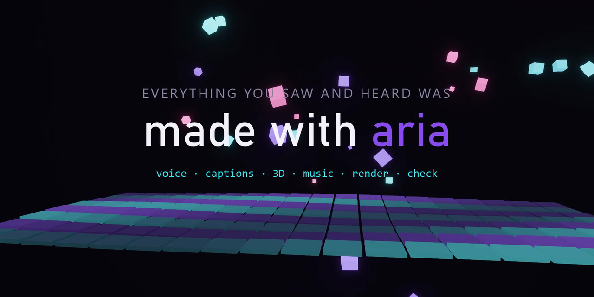

# Aria

**Finished videos with real-sounding voices, made from code, by your coding agent.**



Ask your agent for a video and Aria takes it the whole way, on your own machine:

```
script  →  voice  →  captions  →  scenes  →  render  →  check  →  share
```

- **Voice** that *whispers, laughs, gets excited, gets dramatic*: inline emotion tags (`[happy]`, `[whispering]`,
  `[dramatic]`, `[chuckle]`...), cloned voice presets, and every take heard back by speech recognition and re-spoken
  until every word is right. Word-level timings come out as `captions.json`.
- **Video** written as React + TypeScript: karaoke captions, motion graphics, real 3D (lights, materials, 3D text,
  bloom) and an original score in code, all cued to the exact spoken word, rendered on your GPU.
- **Checked** before you see it: clipped text, safe areas, contrast, loudness and compression artefacts, then
  encoded into a share-ready MP4.

The showcase film in [`examples/showcase`](examples/showcase) was made entirely with Aria: narration, captions, 3D,
music and render. Watch it in the [latest release](../../releases/latest).

## Quick start

Needs Windows 10/11, a GPU with Vulkan or DX12, `ffmpeg` on PATH, and for voice an NVIDIA GPU (~6 GB VRAM).

In Claude Code:
```
/plugin marketplace add Abhinav-murugan1/Aria
/plugin install aria@aria
```
Then the local toolchain (render engine, voice environment, the `aria` command):
```powershell
git clone https://github.com/Abhinav-murugan1/Aria; cd Aria
./install.ps1 -EngineOnly -Voice
aria doctor
```

Codex, Cursor, Gemini CLI, OpenCode, Windsurf, Cline, Kiro, Qoder and others: see [INSTALL.md](INSTALL.md). Every
route needs the same local toolchain.

Then just ask:

> make a 30 second vertical short explaining why we procrastinate, warm narrator, with captions

> make a 16:9 launch video for my app, dramatic voice, 3D logo reveal, upbeat music

> re-voice line 3 with more excitement and make the title land on the word "now"

## Slash commands

| command | does |
|---|---|
| `/aria`, `/aria-video`, `/aria-voice` | load the skills themselves |
| `/aria-help` | list every Aria command |
| `/aria-short TOPIC [9:16\|16:9\|1:1] [voice] [length]` | a finished video end to end (9:16 by default) |
| `/aria-new NAME [shape]` | an empty project from the template |
| `/aria-narrate SCRIPT.json [OUT_DIR]` | voice a script: emotion tags, hearing check, word-timed captions |
| `/aria-retake LINES [direction]` | re-speak lines, e.g. `/aria-retake 3,7 more excited` |
| `/aria-preset NAME KOKORO_VOICE\|REC.wav` | a new expressive voice preset (recordings need your consent) |
| `/aria-emotion WAV...` | the emotion meter, explained |
| `/aria-preview [EDIT.tsx]` | stills of every scene on one contact sheet, reviewed |
| `/aria-make [EDIT.tsx] [NAME]` | render, share copy, export check, fix (at most 3 versions) |
| `/aria-check VIDEO.mp4` | the export check on any video, with a fit-to-publish verdict |
| `/aria-doctor` | check the environment and say how to fix it |

The command-line tool is lowercase `aria` (`aria new`, `aria voice`, `aria make`, ...); the product is Aria.

## Docs

- [INSTALL.md](INSTALL.md): every agent, the toolchain, uninstalling
- [docs/how-it-works.md](docs/how-it-works.md): the pipeline, step by step
- [docs/voice-guide.md](docs/voice-guide.md): writing for the voice, tags, presets, the hearing check
- [docs/cli-reference.md](docs/cli-reference.md): every `aria` verb and flag
- [AGENTS.md](AGENTS.md): the guide any coding agent follows

**Only clone voices you own or have permission to use.** Publishing is always your call.

## Credits

Voice models: [Chatterbox / Chatterbox Turbo](https://github.com/resemble-ai/chatterbox) (Resemble AI, MIT),
[faster-whisper](https://github.com/SYSTRAN/faster-whisper) (MIT),
[Kokoro](https://github.com/thewh1teagle/kokoro-onnx) (Apache-2.0). Music in code: [Tone.js](https://tonejs.github.io/).

## License

[MIT](LICENSE) © Abhinav Murugan
